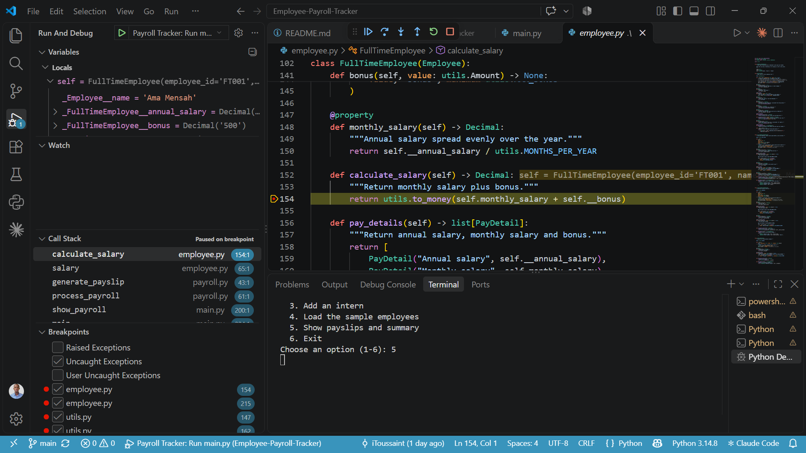
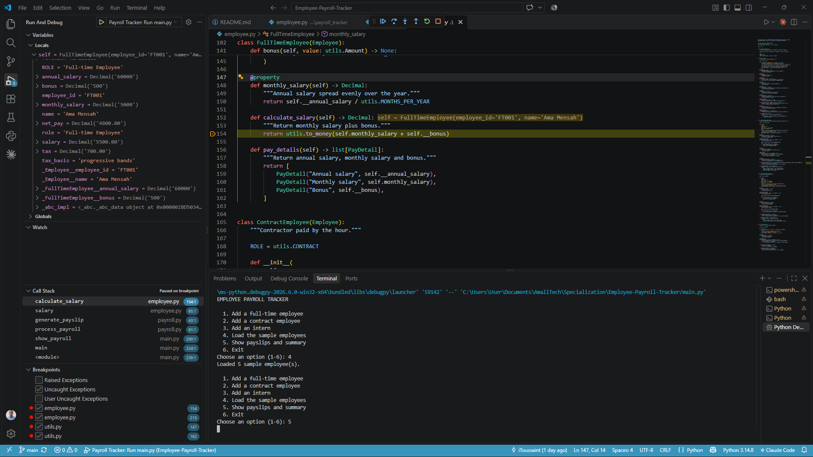
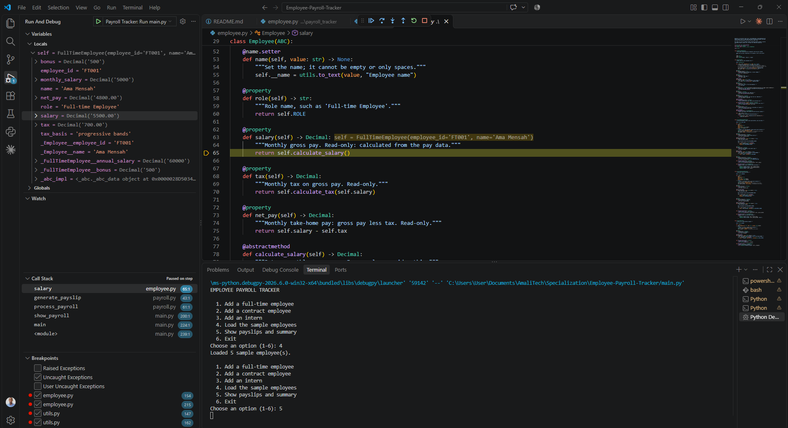
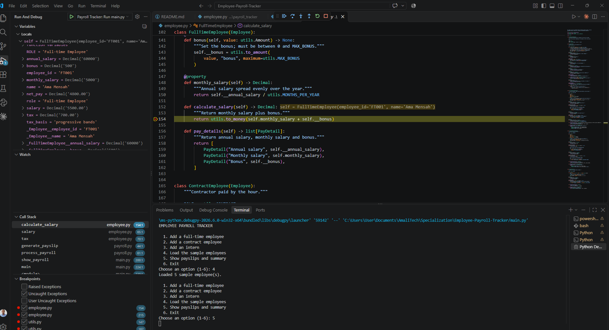
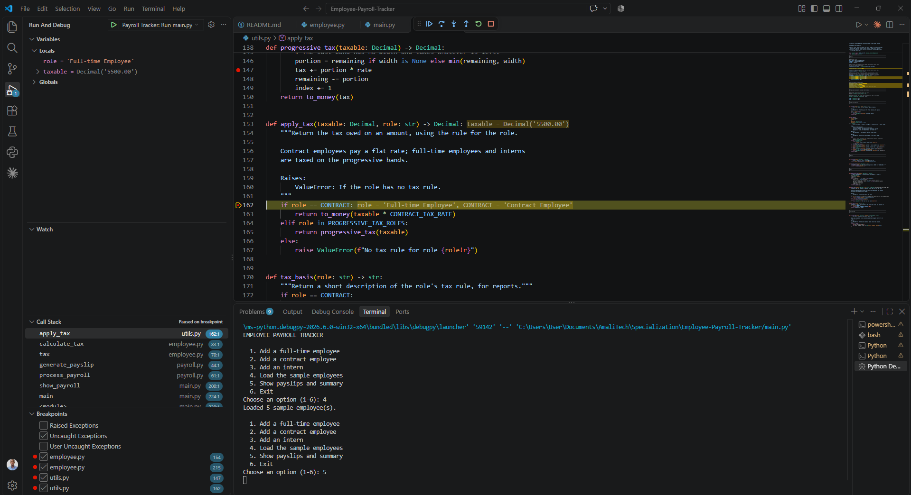
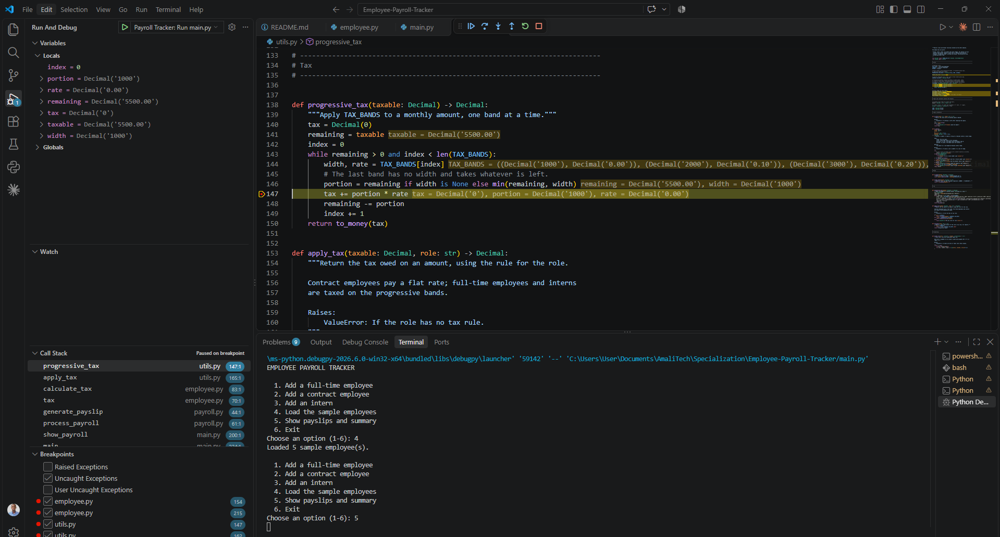

# Employee Payroll Tracker

A command-line Python application that computes monthly payslips for three
kinds of employee: **full-time employees**, **contract employees** and
**interns**. Each role has its own pay and tax rules, built with an
object-oriented class hierarchy.

## Project structure

```
Employee-Payroll-Tracker/
├── main.py         Entry point: interactive menu, formats and prints
│                   the payslip and summary reports
├── employee.py     Employee base class and the three role subclasses,
│                   each overriding calculate_salary()
├── payroll.py      generate_payslip(), process_payroll(),
│                   summarize_by_role()
├── utils.py        Pay rules, apply_tax(), money helpers, validation
├── tests/          pytest tests, one file per module
├── debugging-screenshots/
│                   VS Code debugging session (see Debugging)
├── .vscode/        VS Code settings and debug configurations
├── pyproject.toml  Project settings and dev dependencies (Poetry)
├── poetry.lock     Pinned dependency versions
└── poetry.toml     Poetry settings (virtual environment in .venv/)
```

## Setup

Requirements: Python 3.11 or newer and [Poetry](https://python-poetry.org/).

```bash
git clone <repository-url>
cd Employee-Payroll-Tracker
poetry install
```

`poetry install` creates a virtual environment in `.venv/` and installs the
development tools (pytest, mypy, pycodestyle). The application itself uses
only the Python standard library.

## Usage

```bash
poetry run python main.py
```

or, with any Python 3.11+ interpreter:

```bash
python main.py
```

The program shows a menu:

```
EMPLOYEE PAYROLL TRACKER

  1. Add a full-time employee
  2. Add a contract employee
  3. Add an intern
  4. Load the sample employees
  5. Show payslips and summary
  6. Exit
Choose an option (1-6):
```

- **Options 1-3** ask for the employee's details. Full-time employees need
  an annual salary and an optional bonus, contract employees an hourly rate
  and hours worked, and interns a monthly stipend.
- **Option 4** adds five sample employees covering every role, for a quick
  demonstration.
- **Option 5** prints a payslip for every employee, then a summary by role.
- **Option 6** (or `Ctrl+C`) exits.

Invalid details are rejected with a message and the employee is not added,
so you can simply try again:

```
Choose an option (1-6): 3
Employee ID: IN009
Name: Adjoa Mensah
Monthly stipend: 0
Error: stipend must be greater than 0 (got 0). Employee not added.
```

Duplicate employee IDs, empty names, non-numeric amounts and values outside
the valid ranges are all rejected the same way.

### Running the tests and checks

```bash
poetry run python -m pytest     # unit tests
poetry run python -m mypy       # type checking
poetry run python -m pycodestyle main.py employee.py payroll.py utils.py tests
                                # PEP 8 style check
```

## Payroll rules

All amounts are per month. Rates and limits are defined in
[`utils.py`](utils.py).

| | Full-time | Contract | Intern |
|---|---|---|---|
| **Gross pay** | annual salary / 12 + bonus | hourly rate x hours worked | fixed stipend |
| **Tax** | progressive bands | flat 15% | progressive bands |
| **Net pay** | gross - tax | gross - tax | gross - tax |

**Progressive tax bands (monthly):** first 1,000 at 0%, next 2,000 at 10%,
next 3,000 at 20%, everything above 6,000 at 30%.

**Valid ranges:**

| Field | Allowed range |
|---|---|
| `annual_salary` | greater than 0, up to 1,000,000 |
| `hourly_rate` | greater than 0, up to 1,000 |
| `stipend` | greater than 0, up to 5,000 |
| `bonus` | 0 to 50,000 |
| `hours_worked` | 0 to 744 |

## Design

| Concept | Implementation |
|---|---|
| Base class | `Employee` (abstract) in `employee.py` |
| Subclasses | `FullTimeEmployee`, `ContractEmployee`, `Intern` |
| Inheritance | Subclasses call `super().__init__()` and reuse the base class's ID, name, validation, `salary` / `tax` / `net_pay` properties and tax calculation |
| Encapsulation | Pay data is stored in private attributes (`self.__annual_salary`) |
| Method override | Each role overrides `calculate_salary()` with its own pay rule |
| Properties | `@property` for salary, bonus and tax; setters reject values outside the valid ranges; `salary`, `tax`, `net_pay` and `employee_id` are read-only |
| Polymorphism | `payroll.py` and the reports in `main.py` call the same members on every employee, and the payslip changes with the role |
| Role-based rules | `apply_tax()` in `utils.py` picks the tax rule for each role with `if/elif/else` |
| Data vs display | Employees return raw `PayDetail` values from `pay_details()`; `main.py` formats them for the payslip |
| Lists / dictionaries | Employees are kept in a list; `process_payroll()` returns a dictionary mapping employee IDs to payslips |

## Sample output

Choosing option 4 (load the samples) then option 5 (show payslips) prints a
payslip for each of the five employees, such as:

```
============================================
        PAYSLIP - Contract Employee
============================================
Employee ID                            CT001
Name                           Kwame Boateng
--------------------------------------------
Hourly rate                            25.00
Hours worked                             172
--------------------------------------------
Gross pay                           4,300.00
Tax (flat 15%)                        645.00
--------------------------------------------
NET PAY                             3,655.00
============================================
```

followed by the summary by role:

```
PAYROLL SUMMARY BY ROLE
Role                Count       Gross        Tax         Net
------------------------------------------------------------
Full-time Employee      2   12,500.00   1,800.00   10,700.00
Contract Employee       1    4,300.00     645.00    3,655.00
Intern                  2    2,100.00      20.00    2,080.00
```

## Debugging

The project includes VS Code debug configurations in `.vscode/launch.json`:

- **Payroll Tracker: Run main.py** - runs the application under the debugger
- **Python: Debug Tests** - runs the test suite under the debugger

Open the Run and Debug panel (`Ctrl+Shift+D`), choose a configuration, set
breakpoints and press `F5`. In the menu, choose option 4 then option 5 to run
every calculation and hit the breakpoints.

Useful places for breakpoints:

| Breakpoint | What to inspect |
|---|---|
| `calculate_salary()` in each class in `employee.py` | Step into it from different employees to see polymorphism: the same call runs a different rule per role |
| `apply_tax()` in `utils.py` | Watch which `if/elif/else` branch runs for each role |
| The `while` loop in `progressive_tax()` in `utils.py` | Watch `remaining` and `tax` change band by band |
| `process_payroll()` in `payroll.py` | Watch the `payroll` dictionary fill up, one payslip per employee ID |

### Debugging screenshots

The screenshots below come from one debugging session in VS Code using the
**Payroll Tracker: Run main.py** configuration, with breakpoints in
`employee.py` (lines 154 and 215) and `utils.py` (lines 147 and 162). Option 4
then option 5 were chosen in the menu to load the sample employees and
calculate their payslips.

**1. Paused at a breakpoint in `FullTimeEmployee.calculate_salary()`.**
Execution stops at `employee.py` line 154 for Ama Mensah (FT001). The
Variables panel shows the private, name-mangled attributes
(`_FullTimeEmployee__annual_salary`, `_FullTimeEmployee__bonus`), the Call
Stack shows the path from `show_payroll` in `main.py` through
`process_payroll` and `generate_payslip`, and the Breakpoints panel lists all
four breakpoints.



**2. Inspecting the employee's properties.**
Expanding `self` shows every property value while paused: `monthly_salary`
5000, `salary` 5500.00, `tax` 700.00 and `net_pay` 4800.00, alongside the
`role` and `tax_basis` of the full-time employee.



**3. Stepping out into the inherited `salary` property.**
Stepping out of `calculate_salary()` lands in the base class's `salary`
property (`employee.py` line 65, "Paused on step"). This shows inheritance
and polymorphism at work: the `Employee` base class calls
`self.calculate_salary()`, and Python runs the `FullTimeEmployee` override.



**4. The `tax` property recalculating the salary.**
Continuing hits the same breakpoint again, but the Call Stack now shows
`calculate_salary` called from `salary`, which was called from `tax`: the
read-only `tax` property computes gross pay before taxing it.



**5. The `if/elif/else` role-based tax rule.**
Paused in `apply_tax()` at `utils.py` line 162 with
`role = 'Full-time Employee'` and `taxable = Decimal('5500.00')`. The inline
values show `role` does not equal `CONTRACT`, so the `elif` branch applies the
progressive bands.



**6. The `while` loop over the tax bands.**
Paused inside `progressive_tax()` at `utils.py` line 147 on the first pass of
the loop: `index = 0`, `width = 1000`, `rate = 0.00`, `portion = 1000` and
`remaining = 5500.00`, so the first 1,000 is taxed at 0%. Continuing steps
through each band in turn until `remaining` reaches 0.


